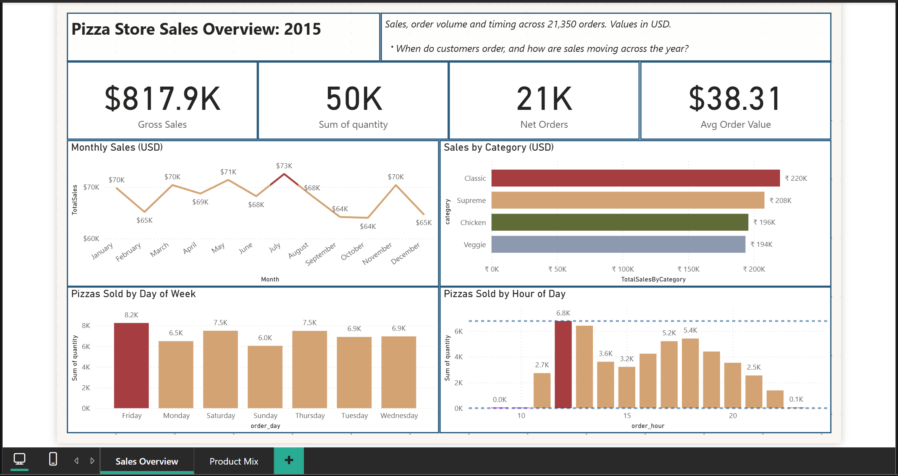

# Pizza Store Sales Performance Analytics


[](screenshots/01_sales_overview.png)

*Select the image to view it at full size.*

---

## Project Overview

A two-page Power BI dashboard of pizza sales for 2015. It shows how sales move across the year, week and day, which pizzas and sizes earn the most, and how the product range is split across categories.

A pizza outlet has a fixed menu and a busy lunch and dinner trade. Management needs to know when demand peaks, which products carry the revenue, and where the menu is under-performing.

The results describe one year of orders at one outlet. They show patterns in the data, not causes.

### Data Source

**Data Source:** Secondary data obtained from publicly available online sources for educational and analytical practice. The dataset was used for data preparation, analysis, dashboard development, and business insights.

---

## Headline KPIs (2015)

| Gross Sales | Orders | Pizzas Sold | Average Order Value |
|---|---|---|---|
| $817,860 | 21,350 | 49,574 | $38.31 |

*Currency: US dollars, assumed. The dataset does not state a currency.*

---

## Business Questions

1. How do sales move across the year?
2. When in the week and the day do orders come in?
3. Which pizzas and sizes earn the most?
4. How is revenue split across the menu's categories?

---

## Dataset

The dataset has four linked tables.

| Table | Rows | Content |
|---|---|---|
| `orders` | 21,350 | One row per order: order ID, date, time |
| `order_details` | 48,620 | One row per pizza line in an order: pizza ID, quantity |
| `pizzas` | 96 | One row per pizza and size: type, size, price |
| `pizza_types` | 32 | One row per pizza type: name, category, ingredients |

| Item | Detail |
|---|---|
| Period | 1 January 2015 to 31 December 2015 |
| Prices | $9.75 to $35.95 |
| Categories | Classic, Supreme, Chicken, Veggie (8, 9, 6 and 9 pizza types) |
| Sizes | S, M, L, XL, XXL |
| Missing values | None |

### Limitations of the data
- **One year, one outlet.** No prior year, so no growth trend.
- **No customer identifiers.** Repeat purchase and customer segments cannot be analysed.
- **No cost data.** Revenue is measured, not profit.
- **No promotions or pricing history.** Price changes over the year cannot be seen.
- **Seven days have no orders.** These include 25 December, 24 and 25 September, and four Mondays in October. The data does not say whether the outlet was closed.

---

## Data Model

The four tables link on `order_id`, `pizza_id` and `pizza_type_id`. Revenue is calculated as quantity × price, from the order lines and the pizza price list.

---

## Key Findings

All figures reproduce from the four data files.

1. **Revenue is spread evenly across the year.** Monthly sales ranged from $64.0K (October) to $72.6K (July). The overall range is narrow, with no single season dominating.

2. **Large pizzas earn almost half of sales.** Size L brings 45.9% of revenue from 18,956 pizzas. Size M brings 30.5%, size S 21.8%, and sizes XL and XXL together 1.8%.

3. **Four categories earn similar shares.** Classic 26.9%, Supreme 25.5%, Chicken 24.0% and Veggie 23.7%. No category dominates.

4. **The top sellers by revenue are chicken pizzas.** The Thai Chicken Pizza earns $43.4K, the Barbecue Chicken Pizza $42.8K and the California Chicken Pizza $41.4K.

5. **The top sellers by volume are different again.** The Classic Deluxe Pizza sells 2,453 units, followed by the Barbecue Chicken Pizza (2,432) and the Hawaiian Pizza (2,422). The Classic Deluxe is fourth by revenue, at $38.2K.

6. **Friday is the busiest day.** It brings $136.1K of revenue and 8,242 pizzas. Sunday is the quietest, with $99.2K and 6,035 pizzas.

7. **Demand peaks at lunch and early evening.** The busiest hour is 12:00, with 2,520 orders and $111.9K of revenue. A second peak falls between 17:00 and 18:59. Orders before 11:00 are rare, with 9 in total.

8. **Most orders are placed in the afternoon and evening.** Afternoon (12:00 to 16:59) accounts for 46.1% of orders, evening (17:00 to 20:59) 39.3%, night (21:00 onwards) 8.9%, and morning (before 12:00) 5.8%.

9. **The lowest seller is a niche pizza.** The Brie Carre Pizza earns $11.6K from 490 pizzas, the smallest share of any type.

### Suggested actions (for discussion, not tested)

- Check staffing and prep for the 12:00 peak and the 17:00 to 18:59 window, since most revenue is earned at those times.
- Review the Brie Carre Pizza and the other low sellers before deciding whether to keep them on the menu.
- Test whether larger sizes can be promoted further, since size L already earns almost half of revenue.

---

## Dashboard

The Power BI report has two pages.

| Page | Purpose |
|---|---|
| **Sales Overview** | Headline KPIs, monthly sales, sales by category, pizzas sold by day of week and by hour |
| **Product Mix** | Top 10 pizzas by revenue and by volume, sales by size, and orders by time of day |

---

## Tools and Techniques

- **Power BI Desktop:** relational data model, DAX measures, slicers and charts.
- **Data model:** the four tables above, with pizza prices from the price list.

---

## Repository Structure

```text
pizza-store-sales-analytics/
├── README.md
├── dashboard/
│   └── pizza store sales dashboard.pbix
├── data/
│   ├── order_details.csv
│   ├── orders.csv
│   ├── pizza_types.csv
│   └── pizzas.csv
├── documentation/
│   └── measures.dax
└── screenshots/
    ├── 01_sales_overview.png
    ├── 02_product_mix.png
    └── 03_data_model.png
```

---

## How to View

1. Open `dashboard/pizza store sales dashboard.pbix` in Power BI Desktop.
2. If a file error appears, point each source to the matching file in `data/` (Home > Transform data > Data source settings).

---

## Limitations

- **One year, one outlet.** Patterns may not hold for other years or locations.
- **Revenue, not profit.** No cost or margin data.
- **No customer view.** Repeat purchase cannot be measured.
- **Closed days are unknown.** Days with no orders may be closures or missing records.
- **Association, not cause.** Lunch peaks describe when orders came in, not why.

---

## Disclaimer

This is a portfolio project using secondary data. Results describe that dataset only and do not represent any real outlet's performance.

---

**Author:** [Sarthak Jaykar](https://www.linkedin.com/in/sarthak-jaykar/)
